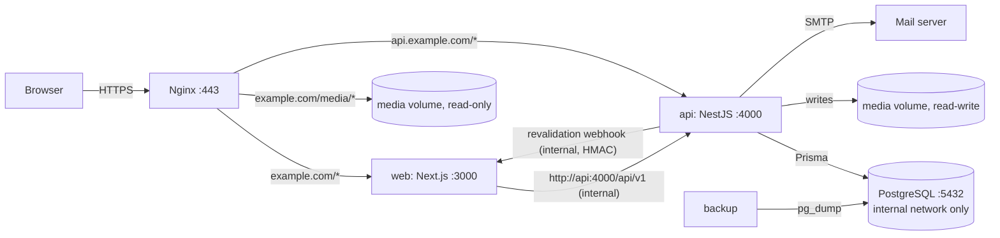
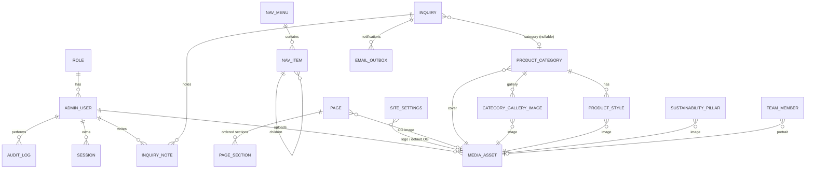

# Phase 2 — Backend Architecture & Technical Design

| | |
|---|---|
| Project | MetaMax Fashions website |
| Phase | 2 of 16 — Architecture and technical design (no code) |
| Date | 2026-11-17 |
| Inputs | [Phase 1 audit](01-frontend-audit.md), master instruction, mandated technology stack |
| Status | Awaiting approval |

**How to read this document**

- **Decided** means it comes from your mandated stack and is not open for change.
- **Proposed** means it is my design choice and needs your approval with this phase.
- **Assumed** means it is a default I used because a Phase 1 question (§12) is still unanswered. Each one is listed in [§19](#19-assumptions-made-for-unanswered-questions) and can be changed cheaply now, before code exists.

---

## 1. Decision summary

| # | Area | Decision | Status |
|---|---|---|---|
| D1 | Frontend | Existing Next.js app: public site + admin UI | Decided |
| D2 | Backend | **NestJS 12** as an independent API application | Decided |
| D3 | Database / ORM | PostgreSQL + **Prisma 7.10.x (stable)** | Decided |
| D4 | Runtime | Node.js **26 LTS** for both apps (amended in Phase 3: 26 became Active LTS in Oct 2026) | Approved |
| D5 | Database version | PostgreSQL **18** | Proposed |
| D6 | Repository | One Git repo, two independent apps: `apps/web` (existing Next.js, moved) + `apps/api` (NestJS). No shared workspace. | Proposed |
| D7 | Contract | NestJS generates an **OpenAPI 3.1** spec; the web app generates TypeScript types from it (`openapi-typescript`). No shared source code between apps. | Proposed |
| D8 | API style | REST, JSON, versioned under `/api/v1`, split into `/public/*` and `/admin/*` | Proposed |
| D9 | Web → API path | **Server-to-server only.** Next.js server code (Server Components, Server Actions, Route Handlers) calls the API over the internal Docker network. The browser never calls the API for admin work. | Proposed |
| D10 | Admin auth | Opaque **server-side sessions** stored in PostgreSQL (hashed token); Next.js keeps the token in an `HttpOnly; Secure; SameSite=Strict` cookie and sends it to the API as `Authorization: Bearer`. No JWT. | Proposed |
| D11 | Authorization | Role-based access with permission keys checked by NestJS guards on every admin endpoint | Proposed |
| D12 | Content model | Shared collections as tables + **Pages → ordered Sections** (typed, validated JSON) | Proposed |
| D13 | Cache invalidation | API sends signed **revalidation webhooks** to Next.js; admin Server Actions also call `updateTag()` | Proposed |
| D14 | Public page rendering | Pages render at **request time** from data cached in Next.js (`"use cache"` + tags), so `next build` does not need the API | Proposed; verified by a spike in Phase 3 |
| D15 | Media | Storage-driver interface; local disk on a Docker volume now, S3-compatible later; files served by Nginx | Proposed |
| D16 | Email | SMTP via `nodemailer` (works with Hostinger business email; no paid service) sent through a database **outbox** | Proposed |
| D17 | Deployment | Docker Compose: `nginx`, `web`, `api`, `db`, `backup`, `certbot`; PostgreSQL on an internal-only network | Decided (stack) / Proposed (details) |
| D18 | CI/CD | GitHub Actions builds and tests; images stored in **GHCR**; deploy over SSH to the **Hostinger KVM 4** VPS; independent pipelines per app; automatic health check + rollback. Full design: [02b-cicd-design.md](02b-cicd-design.md) | Decided (mandate) / Proposed (details) |

---

## 2. Evaluation of the mandated approach (NestJS backend)

You asked for an evaluation, and the stack is mandated. So this section explains what NestJS gives us, what it costs here, and how the design handles each cost. It does not reopen the decision.

| | |
|---|---|
| **Advantages** | **Separation:** the backend has no knowledge of React or the page design, so a full redesign of the website cannot break business logic. **Structure:** NestJS modules, dependency injection, guards, pipes and interceptors suit a long-lived commercial codebase. **Documentation:** first-party OpenAPI (`@nestjs/swagger`) gives you `api.example.com/api/docs` for free. **Reuse:** the same API can later serve a mobile app, a partner portal or an ERP integration without changes. **Deployment:** the backend deploys, restarts and scales on its own. |
| **Costs** | (1) Two applications to build, deploy and monitor instead of one. (2) An extra network hop on every data read. (3) Next.js cache invalidation now crosses a process boundary. (4) Types can drift between apps. (5) A session must work across two apps. |
| **How the design handles the costs** | (1) One Compose file and one deploy script for both (§14). (2) The hop is on the internal Docker network, and Next.js caches results, so most page views make **zero** API calls (§10.5). (3) Signed revalidation webhooks (§10.5). (4) The web app's API types are generated from the OpenAPI spec, and CI fails if they are out of date (§7.6). (5) Server-to-server session design (§8). |

**Conclusion:** the costs are real but bounded. None of them requires adding infrastructure such as Redis or a message queue, so the stack stays exactly as mandated.

---

## 3. System architecture



### 3.1 Request flows

| Flow | Path |
|---|---|
| **Public page view** | Browser → Nginx → Next.js. Next.js reads cached data; on a cache miss it calls `GET /api/v1/public/...` internally → NestJS → PostgreSQL. HTML is streamed back. |
| **Inquiry submission** | Browser → Next.js Server Action (existing form, unchanged UI) → `POST /api/v1/public/inquiries` with the client IP forwarded → NestJS validates, rate-limits, stores and queues the email → response → form success screen. |
| **Admin edit** | Browser → `/admin/...` Server Action → API `PATCH /api/v1/admin/...` with Bearer session → NestJS checks session, checks permission, validates, writes, writes an audit log, sends a revalidation webhook → Server Action also calls `updateTag()` → the admin sees the change immediately. |
| **Media upload** | Browser → Next.js admin Route Handler (streams the file, adds the Bearer session) → `POST /api/v1/admin/media` → NestJS checks file type and size, re-encodes the image, stores it on the volume and saves metadata. |
| **Media view** | Browser → `example.com/media/2026/11/<uuid>.webp` → served by Nginx from the volume (Next.js and NestJS are not involved). `next/image` optimises from that URL. |
| **API docs** | Browser → `api.example.com/api/docs` → NestJS Swagger UI (protection options in §14.4). |

---

## 4. Repository and folder structure

### 4.1 Repository layout (Proposed)

```
/                              repo root
├─ apps/
│  ├─ web/                     existing Next.js app, moved here with `git mv` (history kept)
│  └─ api/                     NestJS application (new)
├─ infra/
│  ├─ compose/                 docker-compose.yml, docker-compose.dev.yml, .env.example
│  ├─ nginx/                   nginx.conf, site configs, security headers
│  └─ scripts/                 deploy.sh, rollback.sh, backup.sh, restore.sh
├─ docs/                       architecture, API, runbooks (this folder)
└─ .github/workflows/          CI: lint, test, build, image publish (optional, see §14.6)
```

**Why move the web app into `apps/web`:** the two apps must build and deploy independently. With Next.js at the repo root, its `tsconfig.json` (`include: **/*.ts`), ESLint config and Docker build context would all pick up the NestJS code. Moving it is a **path change only**; no file content changes.

**Why no npm workspaces / shared package:** a shared package would create a build-time dependency between the apps and complicate both Docker builds. The OpenAPI contract (D7) gives type safety without shared code.

*Alternative if you prefer not to move the frontend:* keep Next.js at the root, put NestJS in `backend/`, and exclude `backend/` in the root `tsconfig.json` and `eslint.config.mjs`. It works but is less clean. I recommend the move.

### 4.2 NestJS application structure

```
apps/api/
├─ src/
│  ├─ main.ts                   bootstrap: helmet, CORS, versioning, validation pipe, Swagger, shutdown hooks
│  ├─ app.module.ts
│  ├─ config/                   env schema + typed ConfigService (fails fast on invalid env)
│  ├─ common/
│  │  ├─ filters/               global exception filter (HTTP, validation, Prisma, unknown)
│  │  ├─ interceptors/          response envelope, request logging context
│  │  ├─ guards/                SessionAuthGuard, PermissionsGuard, InternalRequestGuard
│  │  ├─ decorators/            @Public(), @RequirePermissions(), @CurrentAdmin(), @ClientIp()
│  │  ├─ dto/                   pagination, sorting, id params, envelope schemas
│  │  └─ errors/                domain error classes + stable error codes
│  ├─ infrastructure/
│  │  ├─ prisma/                PrismaService (driver adapter, lifecycle), transaction helper
│  │  ├─ logger/                nestjs-pino setup, redaction rules
│  │  ├─ mail/                  MailService interface, SMTP adapter, templates, outbox worker
│  │  ├─ storage/               StorageDriver interface, LocalDiskDriver (S3Driver later)
│  │  └─ revalidation/          webhook client to Next.js (HMAC signed, retried)
│  └─ modules/
│     ├─ health/                liveness/readiness (Terminus)
│     ├─ auth/                  login, logout, me, change password, sessions, lockout
│     ├─ admin-users/           admin user management
│     ├─ access-control/        roles, permission keys
│     ├─ audit/                 audit log writer + query
│     ├─ settings/              site settings singleton
│     ├─ navigation/            menus + items
│     ├─ pages/                 pages, sections, section-type registry + validators
│     ├─ catalog/               product categories + styles
│     ├─ collections/           services, testimonials, stats, certifications, markets, process & quality steps
│     ├─ media/                 upload pipeline, library, usage checks
│     └─ inquiries/             public submission, admin inbox, notes, export
├─ prisma/
│  ├─ schema.prisma
│  ├─ migrations/
│  └─ seed/                     seed from today's lib/*.ts content (one-time import)
├─ prisma.config.ts
├─ test/                        e2e tests (supertest + real PostgreSQL)
└─ Dockerfile
```

Each module has the same internal layout: `*.controller.ts` (HTTP only) → `*.service.ts` (business rules) → `*.repository.ts` (Prisma queries) plus `dto/`. Controllers never call Prisma directly, and services never see HTTP objects. That keeps business logic testable and independent of transport.

### 4.3 Changes inside the Next.js app (planned for later phases, listed here so the impact is visible)

```
apps/web/
├─ app/
│  ├─ (site)/                   all current public routes move here + their own root layout
│  ├─ (admin)/admin/            admin root layout, login, dashboard, managers (Phase 6)
│  ├─ api/revalidate/route.ts   receives signed webhooks from the API (Phase 10)
│  └─ global-error.tsx          new (Phase 11)
├─ proxy.ts                     optimistic redirect for /admin/* without a session cookie (Phase 5/6)
├─ lib/api/                     generated OpenAPI types + typed fetch client + cached loaders
└─ lib/icons.ts                 allow-listed icon-key → Lucide component registry
```

---

## 5. Application modules

| Module | Responsibility | Depends on |
|---|---|---|
| health | `/health/live`, `/health/ready` (DB ping, storage writable) | prisma, storage |
| auth | Login, logout, current admin, change password, session validation, lockout | admin-users, audit, prisma |
| admin-users | CRUD admin users, assign role, deactivate | access-control, audit |
| access-control | Role definitions, permission keys, guard data | prisma |
| audit | Append-only log of admin writes; query for admins | prisma |
| settings | Company identity, contacts, address, hours, WhatsApp, default SEO, logo | media, revalidation |
| navigation | Header/footer menus with nested items and ordering | revalidation |
| pages | Pages, SEO, ordered sections, section validation, publish state | media, collections, catalog, revalidation |
| catalog | Product categories, styles, galleries, ordering, publish state | media, revalidation |
| collections | Services, testimonials, stats, certifications, markets, process steps, quality steps | media, revalidation |
| media | Upload, validate, re-encode, store, list, alt text, safe delete | storage, prisma |
| inquiries | Public submission, rate limit, store, notify, admin inbox, notes, status, CSV export | mail, catalog |
| mail *(infra)* | Templates, outbox, SMTP sending with retries | prisma |
| revalidation *(infra)* | Map changes → cache tags → signed webhook to Next.js | config |

Dependencies only point from feature modules to infrastructure or to lower-level feature modules, never in a cycle.

---

## 6. Database architecture

### 6.1 Conventions (Proposed)

| Topic | Convention |
|---|---|
| Primary keys | `uuid` (Prisma `@default(uuid(7))` for time-ordered IDs if the pinned Prisma supports it, else v4) |
| Naming | Prisma models in PascalCase; tables and columns mapped to `snake_case` (`@@map`, `@map`) |
| Timestamps | `created_at`, `updated_at` as `timestamptz` on every table |
| Ordering | Integer `position` column + unique index per parent where order matters |
| Publish state | `status` enum (`DRAFT`, `PUBLISHED`, `ARCHIVED`) + `published_at` on publishable content |
| Deletion | Hard delete for content (with audit log entry); soft delete (`deleted_at`) only for media and admin users |
| JSON | `jsonb` only for section `data` and audit `changes`, always validated by the API before writing |
| Slugs | Unique, lowercase, validated pattern; changing a slug is allowed but logged |
| Money | Not applicable (no prices) |
| Migrations | Prisma Migrate; `migrate dev` locally, `migrate deploy` in production (§14.5); never `db push` in production |

### 6.2 Entity relationship overview

Columns are summarised. The full schema is written and reviewed in Phase 4.



| Entity | Key fields | Notes |
|---|---|---|
| `Role` | key (`OWNER`, `EDITOR`, `SALES`), name, permissions `text[]` | Seeded; permission keys defined in code (§9) |
| `AdminUser` | email (unique, citext-style lowercase), name, password_hash, role_id, is_active, failed_login_count, locked_until, last_login_at, deleted_at | No public users exist |
| `Session` | token_hash (unique), admin_user_id, expires_at, last_seen_at, ip, user_agent, revoked_at | Raw token never stored |
| `AuditLog` | admin_user_id, action, entity_type, entity_id, changes `jsonb`, ip, created_at | Append-only; indexed by entity and date |
| `SiteSettings` | single row: names, tagline, description, emails, phones `jsonb[]`→ normalised list, whatsapp, address fields, map query, hours, default SEO, keywords, logo_id | Singleton enforced by a fixed ID |
| `NavMenu` / `NavItem` | menu key (`header`, `footer_company`, `footer_expertise`); item label, href, description, parent_id, position, is_visible | Header dropdown = nested items |
| `Page` | slug (unique), title, seo_title, seo_description, og_image_id, status, published_at | One row per public page |
| `PageSection` | page_id, key, type, position, is_visible, data `jsonb`, schema_version | See §10.3 |
| `ProductCategory` | slug, name, short_name, tagline, description, cover_id, fabrics `text[]`, finishes `text[]`, moq, lead_time, sizes, seo fields, position, status | Fabrics/finishes are simple ordered text lists, kept as arrays |
| `CategoryGalleryImage` | category_id, media_id, position | Ordered gallery |
| `ProductStyle` | category_id, name, image_id, fabric, detail, position, status | Gets a real ID (fixes key collisions) |
| `Service` | slug, icon_key, title, body, points `text[]`, position, status | |
| `Testimonial` | quote, author_role, company, position, status | |
| `Stat` | group (`headline`, `capacity`), value `numeric`, decimals, suffix, label, detail, position | Removes the duplicated "40+" |
| `Certification` | name, note, logo_id?, position | |
| `Market` | name, position | |
| `ProcessStep` / `QualityStep` | title, body, position | Shared by two pages each |
| `ManufacturingCapability`, `SustainabilityPillar`, `CompanyValue` | icon_key, title, body, (image_id), position | Shared by two pages each (Phase 1 §4.2) |
| `TeamMember` | name, nickname, job_title, email, portrait_id, bio, position, is_featured | Holds the MD today; MD message text lives in the MD page's sections |
| `MediaAsset` | storage_key, source (`UPLOAD`/`EXTERNAL`), external_url, mime_type, size_bytes, width, height, alt_text, uploaded_by, deleted_at | `EXTERNAL` keeps today's Unsplash images working during migration |
| `Inquiry` | type, status, name, company, email, phone, country, category_id, category_snapshot, quantity, message, consent_at, consent_text_version, source_path, ip_hash, user_agent, handled_by, created_at | Personal data; access limited to `inquiries.*` permissions |
| `InquiryNote` | inquiry_id, admin_user_id, body | |
| `EmailOutbox` | kind, to, subject, payload `jsonb`, status, attempts, next_attempt_at, last_error, sent_at, inquiry_id? | Reliable delivery without Redis |
| `RateLimitBucket` *(optional)* | key, count, window_start | Only if in-memory throttling proves insufficient; not planned initially |

**Single-page lists stay in sections, not tables.** Examples: About milestones, the custom-design palette and tech-pack list, factory-network regions, partnership models, sustainability commitments, and the home design-showcase stages. They are edited through their page's sections.

### 6.3 Integrity and transactions

- Foreign keys everywhere a relation exists. `ON DELETE RESTRICT` for media references (a used image cannot be deleted); `CASCADE` for children such as sections, gallery rows, styles (only with explicit confirmation in the admin UI) and notes.
- Unique constraints: slugs, admin email, session token hash, `(parent_id, position)` where order is enforced.
- Transactions for: reordering (bulk position update), creating a category with its gallery, inquiry insert + outbox insert, password change + session revocation, publishing a page.
- Indexes: all FKs; `inquiry(status, created_at)`, `inquiry(email)`; `audit_log(entity_type, entity_id)`, `audit_log(created_at)`; `session(admin_user_id)`; `email_outbox(status, next_attempt_at)`.

### 6.4 Seeding

- **Reference seed** (every environment): roles and permissions, system menus, page rows for every existing route.
- **Content import** (one time): a script reads the current `lib/site.ts`, `lib/content.ts`, `lib/catalog.ts`, `lib/images.ts` and inline page arrays, and writes them to the database. Unsplash photos become `EXTERNAL` media assets. After import, the live site looks identical, but the content is in the database.
- **First admin:** created by a CLI command (`npm run admin:create`) run inside the API container. There is no sign-up page.

---

## 7. API specification

### 7.1 Conventions

| Topic | Rule |
|---|---|
| Base URL | `https://api.example.com/api/v1` (internally `http://api:4000/api/v1`) |
| Namespaces | `/public/*` (no auth, read-only except inquiries) · `/admin/*` (session + permission required) · `/health/*` (unversioned) |
| Format | JSON, `camelCase` fields, ISO-8601 UTC timestamps |
| Success envelope | `{ "data": …, "meta": { … } }`; `meta` only for lists |
| Error envelope | `{ "error": { "code": "INQUIRY_RATE_LIMITED", "message": "…", "details": [ … ], "requestId": "…" } }` |
| Status codes | 200 OK · 201 Created · 204 No Content · 400 malformed · 401 no/invalid session · 403 missing permission · 404 · 409 conflict (duplicate slug, media in use) · 413 file too large · 415 bad file type · 422 validation failed · 429 rate limited · 500 · 503 dependency down |
| Pagination | `?page=1&pageSize=20` (max 100); `meta: { page, pageSize, total, totalPages }`. Offset paging suits these data sizes. |
| Sorting | `?sort=createdAt:desc` with an allow-list per endpoint |
| Filtering | Explicit query params per endpoint (e.g. `?status=NEW&type=quotation&q=`) |
| Ordering writes | `PUT …/order` with `{ "ids": [ … ] }` in the new order, applied in one transaction |
| Idempotency | `PUT`/`PATCH`/`DELETE` are idempotent; inquiry `POST` accepts an optional `Idempotency-Key` header to prevent double submits |
| Versioning | URI versioning. Breaking changes → `/api/v2` with v1 kept during migration. Additive changes (new optional fields, new section types) stay in v1. |
| Request ID | Accepts `X-Request-Id` or generates one; echoed in the response header and in every log line |

### 7.2 Public endpoints

| Method | Path | Purpose | Cache tags (web) |
|---|---|---|---|
| GET | `/public/site` | Settings + all visible menus in one call (used by the root layout) | `settings`, `navigation` |
| GET | `/public/pages/{slug}` | Published page + visible sections, with references resolved (stats, testimonials, categories…) | `page:{slug}` + tags of referenced collections |
| GET | `/public/catalog/categories` | Published categories (list cards, sitemap, form options) | `catalog` |
| GET | `/public/catalog/categories/{slug}` | Category with styles, gallery, prev/next | `catalog`, `category:{slug}` |
| GET | `/public/catalog/styles?category=` | Published styles for the explorer | `catalog` |
| GET | `/public/services` | Published services | `services` |
| GET | `/public/testimonials` | Published testimonials | `testimonials` |
| GET | `/public/stats?group=` | Stats by group | `stats` |
| GET | `/public/certifications` · `/public/markets` · `/public/process-steps` · `/public/quality-steps` · `/public/capabilities` · `/public/sustainability-pillars` · `/public/values` | Shared collections | one tag each |
| GET | `/public/team/featured` | MD / featured team members | `team` |
| GET | `/public/sitemap` | Slugs + `updatedAt` for every published page and category | `sitemap` |
| POST | `/public/inquiries` | Submit an inquiry | — |
| GET | `/health/live` · `/health/ready` | Container health | — |

### 7.3 Admin endpoints

All require a valid session. The permission needed is shown in brackets.

| Area | Endpoints |
|---|---|
| Auth | `POST /admin/auth/login` (public, throttled) · `POST /admin/auth/logout` · `GET /admin/auth/me` · `POST /admin/auth/change-password` · `GET /admin/auth/sessions` · `DELETE /admin/auth/sessions/{id}` |
| Admin users `[users.manage]` | `GET/POST /admin/users` · `GET/PATCH/DELETE /admin/users/{id}` · `POST /admin/users/{id}/reset-password` · `GET /admin/roles` |
| Settings `[settings.manage]` | `GET/PATCH /admin/settings` |
| Navigation `[content.write]` | `GET /admin/navigation/{menuKey}` · `POST /admin/navigation/{menuKey}/items` · `PATCH/DELETE /admin/navigation/items/{id}` · `PUT /admin/navigation/{menuKey}/order` |
| Pages `[content.write]`, publish `[content.publish]` | `GET /admin/pages` · `GET/PATCH /admin/pages/{id}` · `POST /admin/pages/{id}/publish` · `POST /admin/pages/{id}/unpublish` · `GET/POST /admin/pages/{id}/sections` · `PATCH/DELETE /admin/sections/{id}` · `PUT /admin/pages/{id}/sections/order` · `GET /admin/section-types` (schemas for the admin editor) |
| Catalog `[catalog.write]` | `GET/POST /admin/catalog/categories` · `GET/PATCH/DELETE /admin/catalog/categories/{id}` · `PUT /admin/catalog/categories/order` · `PUT /admin/catalog/categories/{id}/gallery` · `GET/POST /admin/catalog/categories/{id}/styles` · `PATCH/DELETE /admin/catalog/styles/{id}` · `PUT /admin/catalog/categories/{id}/styles/order` |
| Collections `[content.write]` | For each of `services`, `testimonials`, `stats`, `certifications`, `markets`, `process-steps`, `quality-steps`, `capabilities`, `sustainability-pillars`, `values`, `team`: `GET/POST /admin/{collection}` · `GET/PATCH/DELETE /admin/{collection}/{id}` · `PUT /admin/{collection}/order` |
| Media `[media.write]`, list `[content.write]` | `POST /admin/media` (multipart) · `GET /admin/media?q=&type=&page=` · `GET/PATCH /admin/media/{id}` · `GET /admin/media/{id}/usage` · `DELETE /admin/media/{id}` (409 if in use) |
| Inquiries `[inquiries.read]` / `[inquiries.manage]` | `GET /admin/inquiries?status=&type=&q=&from=&to=` · `GET /admin/inquiries/{id}` · `PATCH /admin/inquiries/{id}` (status, handledBy) · `POST /admin/inquiries/{id}/notes` · `GET /admin/inquiries/export.csv` · `DELETE /admin/inquiries/{id}` (data-erasure requests) |
| Audit `[audit.read]` | `GET /admin/audit-logs?entityType=&entityId=&adminId=&from=&to=` |

### 7.4 Inquiry submission contract (example)

```http
POST /api/v1/public/inquiries
Content-Type: application/json
X-Internal-Key: <shared secret, only when called by Next.js>
X-Client-Ip: 203.0.113.7

{ "type": "quotation", "name": "…", "company": "…", "email": "…", "phone": "…",
  "country": "…", "categorySlug": "denim-jeans", "quantity": "3,000 pcs",
  "message": "…", "consent": true, "website": "", "sourcePath": "/contact" }
```

`201 { "data": { "id": "…", "receivedAt": "…" } }` · `422` with field errors in `details` (mapped back onto the existing form fields) · `429` when rate-limited.

The existing frontend validation rules (`lib/validation.ts`) are kept for instant feedback, but **the API is the authority**. It re-validates everything.

### 7.5 Documentation

- Swagger UI at `/api/docs`, JSON spec at `/api/docs-json`, generated by `@nestjs/swagger` from DTOs and decorators.
- Every endpoint documents its permission, request/response schema, error codes and examples.

### 7.6 Contract between web and API

- `apps/api` exports `openapi.json` during its build (script: `npm run openapi:export`).
- `apps/web` runs `openapi-typescript` on that file to produce `lib/api/schema.d.ts`, and uses a small typed `fetch` wrapper.
- CI regenerates the types and fails if the committed file differs, so drift is caught before deploy.

---

## 8. Authentication architecture

### 8.1 Why server-to-server sessions

The admin UI is on `example.com` and the API on `api.example.com`. If the browser called the API directly with cookies, we would need credentialed CORS and our own CSRF token scheme, and admin pages could not be server-rendered with data. Instead:

```mermaid
sequenceDiagram
  participant B as Browser
  participant W as Next.js (example.com/admin)
  participant A as NestJS (internal)
  participant D as PostgreSQL
  B->>W: POST login (Server Action, Origin-checked)
  W->>A: POST /admin/auth/login {email, password} + X-Client-Ip
  A->>D: verify Argon2id hash, lockout, create Session(token_hash)
  A-->>W: { token, expiresAt, admin }
  W-->>B: Set-Cookie __Host-mmf_admin=token; HttpOnly; Secure; SameSite=Strict; Path=/
  B->>W: GET /admin/catalog (cookie)
  W->>A: GET /admin/catalog/categories  Authorization: Bearer token
  A->>D: look up sha256(token), check expiry/revocation, load role
  A-->>W: data (or 401/403)
  W-->>B: HTML
```

### 8.2 Details

| Topic | Design |
|---|---|
| Password hashing | Argon2id via `@node-rs/argon2` (prebuilt binaries, no native compile in Docker), OWASP-recommended parameters; rehash on login when parameters change |
| Password policy | 12–128 characters; checked against a common-password list; no forced periodic rotation (NIST guidance) |
| Session token | 256-bit random, base64url; only `sha256(token)` stored |
| Lifetime | Idle timeout 2 h (sliding, `last_seen_at` updated at most every 5 min); absolute limit 12 h |
| Logout | Revokes the session in the database and deletes the cookie |
| Password change / reset by Owner | Revokes all of that admin's other sessions |
| Brute force | Per-IP throttle on login (10 / 15 min) + per-account lockout (5 failures → 15 min lock), with generic error messages (no "user not found" leak) |
| CSRF | Browser → Next.js: Server Actions are POST-only with a built-in Origin/Host check, plus a `SameSite=Strict` cookie. Next.js → API: the token travels in the `Authorization` header and the API reads no cookies, so cross-site request forgery against the API is not possible. If browser-direct API calls are ever added, a CSRF scheme must be added at that point. |
| Route protection | `proxy.ts` redirects to `/admin/login` when the cookie is missing (user experience only). Every admin page and action calls the API, which **independently** verifies the session and permission. |
| Caching rule | Admin data is never placed in `"use cache"` scopes; session-dependent data never enters shared caches |
| Client IP trust | The API trusts `X-Client-Ip` **only** when the request carries the correct `X-Internal-Key` (shared secret between web and api). For requests arriving through Nginx, it trusts `X-Real-IP` set by Nginx (Express `trust proxy` = 1 hop). |
| Secrets | `SESSION_PEPPER`, `INTERNAL_API_KEY`, `REVALIDATE_SECRET`, DB and SMTP credentials only in server-side env files on the VPS, never in `NEXT_PUBLIC_*` variables, never committed |
| Password reset | **Assumed:** the Owner resets passwords from the admin panel (no reset email). The email-based flow can be added later through the existing outbox. |

---

## 9. Authorization architecture

Permission keys are defined in code (`access-control/permissions.ts`); roles map to permissions in the database (seeded), so you can adjust a role later without a code change.

| Permission | Owner | Editor | Sales |
|---|:---:|:---:|:---:|
| `users.manage` | ✅ | | |
| `settings.manage` | ✅ | | |
| `content.write` (pages, sections, nav, collections) | ✅ | ✅ | |
| `content.publish` | ✅ | ✅ | |
| `catalog.write` | ✅ | ✅ | |
| `media.write` | ✅ | ✅ | |
| `inquiries.read` | ✅ | | ✅ |
| `inquiries.manage` (status, notes, delete, export) | ✅ | | ✅ |
| `audit.read` | ✅ | | |

- `PermissionsGuard` reads `@RequirePermissions(...)` on each controller method. Endpoints without the decorator are **denied by default** unless marked `@Public()`.
- An admin cannot change their own role or deactivate the last active Owner (enforced in the service, not only the UI).
- **Assumed:** these three roles. If one person does everything, they simply get the Owner role.

---

## 10. Content management architecture

### 10.1 Two kinds of content

| Kind | Examples | Stored as | Edited through |
|---|---|---|---|
| **Entities** — reused on several pages or with their own URL | Settings, navigation, categories, styles, services, testimonials, stats, certifications, markets, process/quality steps, capabilities, sustainability pillars, values, team | Normalised tables | Dedicated admin screens with forms and drag-to-reorder |
| **Page sections** — page-specific copy and layout | Hero text, section headings, intro paragraphs, About milestones, palette, tech-pack list, regions, partnership models, design-showcase stages, CTAs | `PageSection.data` (`jsonb`) validated per section type | Page editor: list of sections, reorder, show/hide, edit fields |

### 10.2 Draft and publish

- Entities and pages have `status` (`DRAFT` / `PUBLISHED` / `ARCHIVED`). Public endpoints return only `PUBLISHED`; individual sections also have `is_visible`.
- **Assumed:** no scheduled publishing and no "edit a draft copy of live content" in v1. Edits to a published item go live on save; to stage a bigger change, create it as a draft and publish when ready. A revision table can be added later without changing existing tables.

### 10.3 Section system

| Field | Purpose |
|---|---|
| `key` | Stable identifier within the page (e.g. `hero`, `overview`). Lets the frontend place a section deliberately when a page needs fixed positions. |
| `type` | Generic content shape, **not** a visual component name. Initial types are derived from the existing components: `hero`, `rich_text`, `heading`, `feature_list`, `steps`, `timeline`, `stats`, `testimonials`, `split_media`, `media_gallery`, `marquee`, `cta`, `category_grid`, `quote`, `key_facts`, `colour_palette`, `checklist`, `region_list` |
| `data` | `jsonb` validated by the type's schema (class-validator DTO per type, versioned) |
| `schema_version` | Lets a type evolve; old versions are migrated by a script, not silently reinterpreted |
| `position`, `is_visible` | Order and visibility controlled from the admin |

**References:** a section can point to shared data instead of copying it. For example, a `stats` section holds `{ "group": "headline" }` and a `testimonials` section holds `{ "limit": 4 }`. `GET /public/pages/{slug}` resolves these, so the frontend makes one request per page.

**Frontend rendering (Phase 8):** a registry maps `type` → existing React component. **Unknown types are skipped and logged, never crash the page.** Redesigning the site means writing new components for the same types; the backend does not change.

**Scope guard:** this is not a free-form page builder. Admins edit, reorder, hide and add sections **of the supported types** on existing pages. Creating new pages with new URLs is out of scope for v1 (a later extension).

### 10.4 Icons and dynamic counts

- Icons are stored as `icon_key` strings (e.g. `factory`). The API validates format and length only. The web app maps keys to an allow-listed set of Lucide icons and falls back to a neutral icon. This keeps the backend independent of the icon library.
- Headings that embed counts ("Twelve categories", "Six reasons") become admin-editable text. Where a count is wanted, the section can use a `{count}` placeholder that the frontend fills from the real data.

### 10.5 Caching and invalidation (the cross-service piece)

| Step | Mechanism |
|---|---|
| Read | Web loaders are `"use cache"` functions with `cacheTag(...)` (tags in §7.2) and a `cacheLife` of hours (a safety net only) |
| Change in API | After a successful transaction, the service emits `content.changed` with the affected tags |
| Webhook | `RevalidationService` POSTs `{ tags, issuedAt }` to `http://web:3000/api/revalidate`, signed with HMAC-SHA256 (`REVALIDATE_SECRET`), with a 5-minute replay window. Retries 3× with backoff; failures are logged with the request ID. |
| In Next.js | The route handler verifies the signature and calls `revalidateTag(tag, "max")`: the next visitor triggers a background refresh and later visitors get fresh content |
| Admin immediacy | Admin Server Actions also call `updateTag(tag)` after a successful API call, so the editor sees the result at once |
| Worst case | If a webhook is lost, content refreshes when its `cacheLife` expires (hours). The admin dashboard shows the last webhook failure. |

### 10.6 Build independence (D14)

Under Cache Components, data fetched during `next build` is baked into prerendered pages, and dynamic routes need at least one static param. If pages fetched from the API at build time, **the web image could not be built without a running API**, which breaks "independently buildable". Proposed approach:

- Public data loaders run at **request time** (behind `await connection()` / Suspense boundaries), with their results cached by `"use cache"` + tags. The static shell (layout chrome) still prerenders; content streams in the same HTML response, so SEO is unaffected.
- `/products/[slug]` drops `generateStaticParams` (or keeps one placeholder param) and resolves slugs at request time from cached data.
- **Risk:** this is a less common pattern in Next.js 16. Phase 3 includes a **small spike** to prove it builds with the API offline and renders correctly. If it fails, the fallback is to build the web image against the running production API, with documented deploy ordering (API first, then web).

---

## 11. Media storage architecture

```ts
interface StorageDriver {
  put(key: string, body: Readable, contentType: string): Promise<void>;
  delete(key: string): Promise<void>;
  exists(key: string): Promise<boolean>;
  publicUrl(key: string): string;      // MEDIA_PUBLIC_BASE_URL + key
}
```

| Topic | Design |
|---|---|
| Driver now | `LocalDiskDriver` → `/data/media` on the `media` Docker volume (the API mounts it read-write, Nginx read-only) |
| Driver later | `S3Driver` for any S3-compatible service, selected by `STORAGE_DRIVER=s3`. Business logic only calls the interface; switching needs a file copy + config change, no code changes in modules. |
| Public URL | `https://example.com/media/{yyyy}/{mm}/{uuid}.{ext}`, served by Nginx with long-lived immutable caching (keys are never reused) |
| Upload limits | Images: JPEG, PNG, WebP, AVIF; max 10 MB, max 8000 × 8000 px. SVG only for the logo in settings, sanitised; otherwise rejected. |
| Validation | Real file signature (magic bytes via `file-type`), not the extension or the client's MIME claim; decoded by `sharp` (anything that fails to decode is rejected) |
| Processing | Re-encode with `sharp` (strips EXIF/GPS and any embedded payloads), auto-rotate, record width/height. No resized variants are stored; `next/image` already produces responsive sizes. |
| Naming | Random UUID keys; the original filename is stored only as metadata (sanitised) |
| Metadata | `MediaAsset` row (§6.2), alt text required before use in content |
| Deletion | Blocked (409) while referenced by FKs or section JSON (checked with a `jsonb` query); otherwise soft-deleted, then the file is removed by a daily cleanup after 7 days (time to undo mistakes) |
| Unsplash migration | Imported photos are `EXTERNAL` assets with their Unsplash URL; `next.config.ts` keeps the Unsplash remote pattern until all are replaced. The frontend's `photo(id)` becomes a resolver that accepts a media object. |
| Inquiry attachments | Not included (**Assumed**, Phase 1 Q4). If wanted later: private storage path, served only to admins through the API, size/type limits, optional malware scan. |

---

## 12. Error-handling architecture

| Layer | Handling |
|---|---|
| Validation | Global `ValidationPipe` (`whitelist`, `forbidNonWhitelisted`, `transform`) → 422 with per-field `details` |
| Domain errors | Services throw typed errors (`NotFoundError`, `ConflictError`, `RateLimitedError`, `MediaInUseError`…) carrying a stable `code` |
| Prisma errors | Mapped in the global filter: `P2002` → 409 `DUPLICATE`, `P2025` → 404, connection errors → 503 |
| Unknown errors | 500 with a generic message + `requestId`; full stack trace logged server-side only |
| Shutdown | `enableShutdownHooks()`; Prisma disconnects cleanly; Docker `stop_grace_period` set |
| Web side (Phase 11) | Typed API client returns `{ data } \| { error }`; sections render empty states instead of crashing; `global-error.tsx` added; `error.tsx` boundaries per route group; Server Actions map 422 errors back onto form fields and 429 onto a friendly message |
| Rule | No empty `catch` blocks, no silent fallbacks: every caught error is either handled with a user-facing message or logged with context and rethrown |

---

## 13. Logging and audit architecture

| Concern | Design |
|---|---|
| Application logs | `nestjs-pino`: structured JSON to stdout, one line per request (method, path, status, duration, requestId, adminId if any) |
| Redaction | `authorization`, `cookie`, `password`, `token`, inquiry `email`/`phone`/`message` are redacted in logs |
| Log levels | `info` in production, `debug` in development; configured by `LOG_LEVEL` |
| Correlation | `X-Request-Id` passed from Next.js to the API and returned in error responses, so a user-reported error can be traced across both apps |
| Next.js logs | Server errors logged as JSON to stdout with the same request ID |
| Storage | Docker `json-file` driver with rotation (`max-size: 10m`, `max-file: 5`) per container (Phase 14) |
| Audit trail | `AuditLog` rows for every admin write: who, what entity, which fields changed (before/after, sensitive fields excluded), IP, time. Viewable by Owners. Retained 2 years (configurable). |
| Monitoring | Health endpoints for Docker/Nginx; CPU, memory and disk monitoring in Phase 14 |

---

## 14. Deployment architecture (Hostinger VPS)

### 14.1 Services

| Service | Image | Networks | Ports | Volumes | Restart |
|---|---|---|---|---|---|
| `nginx` | `nginx:stable-alpine` + config | `edge` | **80, 443 (only public ports)** | certs, `media` (ro) | `unless-stopped` |
| `certbot` | `certbot/certbot` | — | none | certs, webroot | renew loop |
| `web` | `apps/web` (Next.js `output: "standalone"`, Node 24 alpine, non-root) | `edge`, `app` | internal 3000 | `next-cache` (optional) | `unless-stopped` |
| `api` | `apps/api` (NestJS, Node 24 alpine, non-root) | `edge`, `app`, `data` | internal 4000 | `media` (rw) | `unless-stopped` |
| `db` | `postgres:18-alpine` | `data` (`internal: true`) | **none published** | `pgdata` | `unless-stopped` |
| `backup` | small image with `pg_dump` + cron | `data` | none | `backups` | `unless-stopped` |

The `data` network is internal-only: PostgreSQL has no route to or from the internet, and only `api` and `backup` can reach it.

### 14.2 Nginx routing

| Host / path | Upstream |
|---|---|
| `example.com/media/*` | Static files from the media volume (`immutable` cache headers, `nosniff`) |
| `example.com/*` | `web:3000` |
| `api.example.com/*` | `api:4000` |
| `www.example.com` | 301 → `example.com` |
| HTTP | 301 → HTTPS (except the ACME challenge path) |

Plus: HSTS, TLS 1.2/1.3 only, request body limit (12 MB on the media upload path, 1 MB elsewhere), gzip/brotli for text, `X-Real-IP`/`X-Forwarded-*` headers.

### 14.3 Security headers

- Nginx: HSTS, and the existing headers from `next.config.ts` (kept in one place).
- A **Content Security Policy** is added to the web app in Phase 12, allowing the Google Maps iframe, Unsplash (until migration ends) and the media path.

### 14.4 API documentation exposure

`/api/docs` is public in development and staging. **Proposed** for production: protected by Nginx basic auth (or limited to admins), because the docs reveal the full admin surface. Your routing table lists it publicly, so this needs your decision (§20).

### 14.5 Build, deploy, restart

| Event | What happens |
|---|---|
| Code change | GitHub Actions tests and builds a new image for the app that changed, tags it with the Git commit SHA and pushes it to GHCR. The deploy job then runs `deploy.sh` on the VPS: pull → (api) pre-migration backup + `prisma migrate deploy` in a one-off container → recreate that one service → wait for health → smoke test → automatic rollback on failure. Details: [02b-cicd-design.md §5](02b-cicd-design.md#5-the-deploy-job-and-the-vps-side). |
| VPS reboot | Docker starts the **existing images** (`restart: unless-stopped`). Nothing is rebuilt and no migrations run. |
| Rollback | Re-deploy the previous image tag. Migrations are written to be backward-compatible (expand → migrate → contract across releases), so the old code keeps working against the new schema. A database restore is the last resort and is documented separately. |
| Backups | Nightly `pg_dump` (custom format) kept 14 days locally + weekly copies; **off-server copy strongly recommended** (destination to be decided in Phase 14). The media volume is backed up with the same schedule. Restore is tested in Phase 15. |

### 14.6 Where images are built

**Decided (CI/CD mandate):** GitHub Actions builds every image and pushes it to GitHub Container Registry. The VPS (Hostinger KVM 4) only pulls and runs images; it never builds them. The production `compose.yml` has no `build:` keys, so a restart can only reuse existing images. Pipelines, secrets, migrations, rollback, retention and the KVM 4 resource plan are in [02b-cicd-design.md](02b-cicd-design.md).

---

## 15. Environments and configuration

| Environment | How it runs |
|---|---|
| Development | `docker-compose.dev.yml` runs only PostgreSQL (and Mailpit to catch emails locally); `web` and `api` run with `npm run dev` |
| Test | Separate PostgreSQL database; API e2e tests reset it per run |
| Production | Full Compose stack on the VPS |

Required environment variables (validated at startup; the app refuses to start if any are missing or invalid):

| App | Variables |
|---|---|
| api | `NODE_ENV`, `PORT`, `DATABASE_URL`, `CORS_ORIGINS`, `SESSION_PEPPER`, `SESSION_IDLE_MINUTES`, `SESSION_ABSOLUTE_HOURS`, `INTERNAL_API_KEY`, `REVALIDATE_URL`, `REVALIDATE_SECRET`, `STORAGE_DRIVER`, `MEDIA_ROOT`, `MEDIA_PUBLIC_BASE_URL`, `SMTP_HOST`, `SMTP_PORT`, `SMTP_USER`, `SMTP_PASS`, `MAIL_FROM`, `INQUIRY_NOTIFY_TO`, `LOG_LEVEL`, `SWAGGER_ENABLED` |
| web | `NEXT_PUBLIC_SITE_URL`, `API_INTERNAL_URL`, `INTERNAL_API_KEY`, `REVALIDATE_SECRET`, `MEDIA_PUBLIC_BASE_URL`, `ADMIN_COOKIE_NAME` |
| db | `POSTGRES_DB`, `POSTGRES_USER`, `POSTGRES_PASSWORD` |

A committed `.env.example` per app documents each variable; real `.env` files live only on the VPS with `600` permissions.

---

## 16. Testing strategy (summary; detailed in Phase 13)

| Level | Tooling | Focus |
|---|---|---|
| API unit | Jest (NestJS default) | Services, validators, section schemas, permission logic |
| API integration / e2e | Jest + supertest + real PostgreSQL | Every endpoint: auth, 401/403, validation, pagination, transactions, rate limits, upload rejection |
| Web unit | Vitest + Testing Library | API client, loaders, section registry, empty/unknown-section handling |
| End-to-end | Playwright | Public pages render, inquiry submit, admin login → edit → public page updates |
| Contract | OpenAPI type regeneration check in CI | Web/API drift |

Rule kept from your brief: results are reported only from tests that were actually run.

---

## 17. How later phases map onto this design

| Phase | Delivers (under this design) |
|---|---|
| 3 Foundation | Next.js security upgrade; repo restructure (`apps/web`, `apps/api`); GitHub Actions `checks` jobs + branch protection; NestJS skeleton with config validation, Prisma connection, pino logging, exception filter, validation pipe, Swagger, helmet, CORS, health checks; dev Compose with PostgreSQL; **build-independence spike (§10.6)** |
| 4 Database | Full Prisma schema, first migration, reference seed, content-import script, constraint/index review |
| 5 Auth | Admin users, roles, sessions, Argon2id, lockout, throttling, guards, `admin:create` CLI, audit writer |
| 6 Admin panel | `(site)`/`(admin)` route groups, admin root layout, login, dashboard, navigation shell, proxy redirect |
| 7 CMS | Settings, navigation, collections, catalog APIs + admin screens; web reads them via cached loaders; webhook revalidation |
| 8 Sections | Section types + validators, page editor, frontend section registry, migration of inline page content |
| 9 Media | Upload pipeline, media library UI, `photo()` → resolver, Unsplash → `EXTERNAL` assets |
| 10 Integration | Inquiry API + outbox email + admin inbox; remaining mock data replaced; loading/empty/error states |
| 11 Resilience | `global-error.tsx`, per-section error boundaries, fixes for the Phase 1 empty-data crashes |
| 12 Security | CSP, dependency audit, header review, upload fuzzing, auth review |
| 13 Testing | Full suites per §16 |
| 14 Infrastructure | Production Compose, Nginx, TLS, firewall (UFW: 22/80/443 only), SSH hardening, backups, log rotation, monitoring |
| 15 Deployment | Image builds, deploy/rollback scripts, restore test, reboot-recovery test |
| 16 Handover | Final docs set |

---

## 18. Risks and mitigations

| Risk | Impact | Mitigation |
|---|---|---|
| Request-time rendering pattern under Cache Components does not behave as expected (§10.6) | Web build would depend on the API | Spike in Phase 3 before any feature work; documented fallback |
| Lost revalidation webhook | Stale content for up to the `cacheLife` window | Retries, logged failures, dashboard indicator, "refresh site cache" admin button |
| VPS resource contention | Image optimisation or uploads slow the site | Builds never run on the VPS (CI only); per-container memory/CPU limits for KVM 4; `sharp` concurrency capped; monitoring ([02b §10](02b-cicd-design.md#10-resource-plan-for-hostinger-kvm-4)) |
| Prisma `latest` npm tag currently points to an 8.0 **release candidate** | An unplanned beta install | Pin exact stable versions (`prisma@7.10.1`, `@prisma/client@7.10.1`) and update deliberately |
| Single server = single point of failure | Downtime if the VPS fails | Off-server backups + a tested restore procedure; documented rebuild steps |
| Content import misses inline text | Live site differs after cutover | Import script + visual comparison of every page before/after (Phase 7/8) |
| Inquiry personal data (GDPR, EU/UK buyers) | Legal exposure | Minimal fields, IP stored only as a salted hash, access limited to the Sales/Owner roles, deletion endpoint, retention policy, privacy page (Phase 1 Q11) |

---

## 19. Assumptions made for unanswered questions

These are defaults so the design is complete. Each can be changed now at low cost.

| Phase 1 question | Default used in this design |
|---|---|
| Q1 Admin users and roles | 3 roles: Owner, Editor, Sales (§9) |
| Q2 Notifications | SMTP (Hostinger business email); notifications to a configurable list (`INQUIRY_NOTIFY_TO`); **an automatic acknowledgement email to the buyer is included** |
| Q3 Inquiry workflow | Statuses `NEW → IN_PROGRESS → QUOTED → CLOSED_WON / CLOSED_LOST / SPAM`, internal notes, CSV export |
| Q4 Tech-pack upload | **Not included** in v1 (§11) |
| Q5 Catalog depth | Category + styles as today; no per-style pages |
| Q6 Editing flexibility | Section system limited to supported types on existing pages (§10.3) |
| Q7 Scheduling | Draft/publish only; no scheduled publishing |
| Q8 Password reset | Owner resets passwords; no reset email |
| Q9 Other API consumers | None planned; the API is designed so they can be added |
| Q10 Domain | `example.com` placeholder; all hosts come from env variables |
| Q11 Privacy policy | A CMS-editable `/privacy` page is added in Phase 8, linked from the consent checkbox (content to come from you) |

---

## 20. Decisions needed from you to approve Phase 2

1. **Approve the overall design** (§1 decisions D4–D17).
2. **Repository restructure:** move the existing Next.js app into `apps/web` (recommended) or keep it at the root (§4.1).
3. **Next.js security upgrade** 16.4.4 → 16.4.6 as the first step of Phase 3 (needed for production builds to pass).
4. **API docs in production:** protected (recommended) or public (§14.4)?
5. ~~Image builds~~ — **settled by your CI/CD mandate** (GitHub Actions + GHCR, Hostinger KVM 4). Four CI/CD choices remain in [02b-cicd-design.md §12](02b-cicd-design.md#12-decisions-for-you).
6. **Confirm or change the assumptions** in §19. Silence = accepted.

---

## 21. Phase 2 report

| Item | Result |
|---|---|
| Completed work | Backend architecture and technical design for the mandated stack: system architecture, repo/module structure, data model, API specification, authentication, authorization, CMS and section design, caching/invalidation across services, media, error handling, logging/audit, deployment, environments, testing outline, risks |
| Files created | `docs/backend/02-architecture.md` |
| Files modified | `docs/backend/PROGRESS.md` (status) |
| Code, packages, database, APIs | None (design phase) |
| Research done | Current versions checked on npm: next 16.4.6, @nestjs/core 12.5.1, prisma/@prisma/client 7.10.1 stable (CLI `latest` tag is 8.0.0-rc.34), @nestjs/swagger 12.1.2, nestjs-pino 5.3.2. Next.js 16 docs read for `revalidateTag`, `updateTag`, `connection`, `generateStaticParams` under Cache Components, multiple root layouts, self-hosting. |
| Tests executed | None (no code in this phase) |
| Known limitations | §10.6 request-time rendering is unproven until the Phase 3 spike. Prisma 7 setup details (`prisma.config.ts`, `prisma-client` generator, `@prisma/adapter-pg`) will be confirmed against the pinned version's docs in Phase 3. Exact table columns are finalised in Phase 4. |
| Recommended next phase | **Phase 3 — Production-grade backend foundation**, after the decisions in §20 |

---

## 22. Amendments made during Phase 3

Implementation used newer first-party NestJS 12 features in place of some libraries named above. Details and reasons: [03-foundation.md §4](03-foundation.md#4-deviations-from-the-phase-2-design-and-why).

- Validation: **Zod** + `StandardSchemaValidationPipe` (instead of class-validator). This also applies to section `data` schemas (§10.3).
- Logging: Nest **built-in JSON logger** with redaction (instead of nestjs-pino).
- Security headers: `app.useSecurityHeaders()` (instead of helmet).
- Tests: **Vitest**; API lint: **oxlint**.
- Health endpoints: `/api/health/live`, `/api/health/ready`.
- The API starts even when PostgreSQL is down; readiness reports it.
- Prisma config file: `prisma7.config.ts`; `prisma` is a runtime dependency of the API image.
- D14 (request-time rendering) is confirmed by the Phase 3 spike, with two constraints: URL-reading client components must sit in Suspense, and unknown slugs return 200 + `noindex` unless handled in `proxy.ts` (decision in Phase 10).
