# Phase 2 (addendum) — CI/CD Deployment Design

| | |
|---|---|
| Part of | Phase 2 — Architecture (extends [02-architecture.md §14](02-architecture.md#14-deployment-architecture-hostinger-vps)) |
| Date | 2026-11-17 |
| Mandate | GitHub + GitHub Actions + Docker + Docker Compose + GHCR + Hostinger KVM 4 VPS |
| Repository | `github.com/Mahmudus-Sami-Maahi/Bying-House`, production branch `main` |
| Status | Awaiting approval (with Phase 2) |

This replaces the open "where are images built" question (Phase 2 §14.6). **Images are built only by GitHub Actions and stored in GHCR. The VPS never builds application images.**

---

## 1. Pipeline overview

```mermaid
flowchart LR
  Dev[Developer] -- PR --> PR[Pull request to main]
  PR -- checks --> CI{Lint · typecheck · tests · build}
  CI -- all green + review --> Merge[Merge to main]
  Merge --> CI2{Same checks on main}
  CI2 --> Build[Build image<br/>GitHub runner]
  Build --> Scan[Vulnerability scan]
  Scan --> Push[Push to GHCR<br/>tag: sha-xxxxxxx]
  Push --> Gate[GitHub Environment 'production']
  Gate -- SSH (pinned host key) --> VPS[deploy.sh on VPS]
  VPS --> Pull[docker pull new tag]
  Pull --> Backup[Pre-migration DB dump<br/>api only]
  Backup --> Migrate[prisma migrate deploy<br/>one-off container, api only]
  Migrate --> Up[Recreate one service]
  Up --> Health{Healthy + smoke test?}
  Health -- yes --> Record[Record tag, keep previous]
  Health -- no --> Rollback[Auto-rollback to previous tag]
```



The pipeline follows your 8 steps exactly:

| Your step | Where it happens |
|---|---|
| 1 Push approved changes to the production branch | PR → review → merge to `main` (branch protection, §6) |
| 2 Lint, type checks, automated tests | `checks` job, on every PR and again on `main` |
| 3 Build production images for Next.js and NestJS | `build` job on GitHub-hosted runners (not on the VPS) |
| 4 Push to GHCR | Same job, immutable tag `sha-<7 chars>` |
| 5 Connect securely to the VPS and deploy | `deploy` job, SSH with a deploy-only key and pinned host key, restricted to one script |
| 6 Run Prisma migrations in a controlled way | `deploy.sh api` runs `prisma migrate deploy` in a one-off container **before** switching the API, after a safety backup |
| 7 Verify health before calling it a success | Docker health status + HTTPS smoke tests through Nginx |
| 8 Retain the previous image for rollback | Previous tag recorded on the VPS; images kept locally and in GHCR (§8) |

---

## 2. Workflows (independent per application)

| Workflow file | Trigger | Jobs |
|---|---|---|
| `.github/workflows/api.yml` | PR or push touching `apps/api/**`; manual run | `checks` → (main only) `build` → `deploy` |
| `.github/workflows/web.yml` | PR or push touching `apps/web/**`; manual run | `checks` → (main only) `build` → `deploy` |
| `.github/workflows/infra.yml` | Push touching `infra/**`; manual run | validate configs → sync Compose/Nginx files to the VPS → `nginx -t` → reload |
| `.github/workflows/rollback.yml` | Manual only (`app`, optional `tag`) | Redeploy a previous image tag without building |
| `.github/workflows/ghcr-cleanup.yml` | Weekly schedule | Delete old untagged/superseded images in GHCR, always keeping the newest 10 per app |

**Independence:** a frontend-only change never rebuilds or restarts the API, and the reverse. Each workflow can be re-run or rolled back on its own.

**Serialised deploys:** all deploy jobs share the concurrency group `production-deploy` with `cancel-in-progress: false`. Two deploys never touch the VPS at the same time, and a deploy is never cancelled halfway.

**Compatibility between apps:** if one push changes both apps, the two workflows may deploy in either order. The rule that makes this safe: API changes in `/api/v1` are **additive only** (new endpoints, new optional fields). Breaking changes go to `/api/v2`, with v1 kept until the web app has moved over.

---

## 3. The `checks` job

Runs on `ubuntu-latest` with Node 24 and npm cache.

| App | Steps |
|---|---|
| **api** | `npm ci` → `eslint` → `tsc --noEmit` → `prisma validate` → unit tests → e2e tests against a **PostgreSQL 18 service container** (applies all migrations from scratch, which proves they work) → migration drift check (schema vs migrations) → `npm run openapi:export` and fail if `openapi.json` changed but was not committed → `npm audit --omit=dev --audit-level=high` |
| **web** | `npm ci` → `eslint` → `tsc --noEmit` → regenerate API types from the committed `openapi.json` and fail on difference → unit tests → `next build` → `npm audit --omit=dev --audit-level=high` |

A failing check stops the workflow: nothing is built or deployed.

Playwright end-to-end tests (Phase 13) run against the full Compose stack started inside the runner, on PRs to `main`.

---

## 4. The `build` job

| Topic | Design |
|---|---|
| Builder | `docker/setup-buildx-action` + `docker/build-push-action`, on GitHub-hosted runners |
| Platform | `linux/amd64` (Hostinger KVM VPS architecture) |
| Dockerfiles | Multi-stage: deps → build → minimal runtime on `node:24-alpine`; non-root user; `HEALTHCHECK` defined. Web uses Next.js `output: "standalone"` (only the files needed to run). API runtime stage contains compiled JS, production `node_modules`, the Prisma client and migrations. |
| Expected size | Roughly 150–250 MB per image (to be measured in Phase 15) |
| Layer cache | GitHub Actions cache (`cache-from/to: type=gha`), so unchanged dependency layers are not rebuilt |
| Tags | `ghcr.io/mahmudus-sami-maahi/bying-house-web:sha-<7>` and `…/bying-house-api:sha-<7>` (immutable). A moving `main` tag is also pushed for convenience but **deploys always use the SHA tag**. GHCR requires lowercase names. |
| Labels | OCI labels: source repo, commit SHA, build time; the commit SHA is also baked in as `APP_VERSION` and returned by `/health/live` |
| Build-time variables | Only non-secret, public values (e.g. `NEXT_PUBLIC_SITE_URL`, which Next.js inlines at build time), from **GitHub Actions Variables**. **No secrets are ever passed into an image build.** |
| Scan | Trivy image scan; the job fails on **critical** vulnerabilities with an available fix (reported, not blocking, for high) |
| Push auth | The built-in `GITHUB_TOKEN` with `packages: write`, scoped to the workflow run; no personal token needed for pushing |
| Visibility | GHCR packages stay **private** |

---

## 5. The `deploy` job and the VPS side

### 5.1 How GitHub reaches the VPS

| Measure | Detail |
|---|---|
| Dedicated user | `deploy` user on the VPS (not root) |
| Key | ed25519 deploy key generated only for CI; private key in the GitHub secret `VPS_SSH_KEY` |
| Forced command | In `~deploy/.ssh/authorized_keys` the key is restricted with `command="/opt/metamax/bin/deploy-entry",no-port-forwarding,no-agent-forwarding,no-X11-forwarding,no-pty`. **This key can only run the deploy script**, with validated arguments, even if it leaks. |
| Host verification | The VPS host key is stored in the secret `VPS_KNOWN_HOSTS`; `StrictHostKeyChecking=yes`. No trust-on-first-use. |
| Approval gate | The job runs in the GitHub Environment `production`. Optionally require a reviewer's approval before each production deploy (recommended once more than one person can push). |
| Registry pull | The VPS logs in to GHCR once at setup with a token that has **only** `read:packages`, stored in the deploy user's Docker config. The CI never sends a registry token to the server. |

### 5.2 Directory layout on the VPS

```
/opt/metamax/
├─ compose.yml              production Compose file (no `build:` keys at all)
├─ nginx/                   Nginx configs (synced by infra.yml)
├─ env/
│  ├─ api.env               runtime secrets (DB, SMTP, session pepper…), mode 600, never in Git
│  ├─ web.env               runtime config/secrets, mode 600
│  └─ db.env                PostgreSQL credentials, mode 600
├─ state/
│  ├─ current.env           API_IMAGE_TAG=sha-…  WEB_IMAGE_TAG=sha-…   (read by Compose)
│  ├─ previous.env          last known-good tags (rollback target)
│  └─ deploy.log            one line per deploy: time, app, from → to, result
└─ bin/
   ├─ deploy-entry          parses the SSH command, allows only: deploy <app> <tag> | rollback <app> | status
   ├─ deploy.sh
   └─ backup.sh / restore.sh
```

`compose.yml` references images as `ghcr.io/…/bying-house-api:${API_IMAGE_TAG}`. Because there is **no `build:` key**, Docker Compose cannot rebuild anything: on reboot it starts the exact images named in `current.env`.

### 5.3 `deploy.sh <app> <tag>` (step by step)

1. Take a lock (`flock`) so only one deploy runs at a time on the server.
2. Validate: `app` ∈ {`web`, `api`}, `tag` matches `sha-[0-9a-f]{7}`.
3. `docker pull` the new image. If the pull fails, stop: nothing has changed.
4. **API only:** run `backup.sh --pre-deploy` (a quick `pg_dump` kept for 7 days).
5. **API only:** `docker compose run --rm --no-deps api-migrate` using the **new** image → `prisma migrate deploy`. If a migration fails, stop: the old API keeps running on the unchanged or partially migrated schema (see §7 for why that is safe).
6. Write the new tag to a temporary state file and run `docker compose up -d --no-deps <app>`. Only that one container is recreated. Volumes, the database and the other app are not touched.
7. Wait up to 90 s for Docker health status `healthy`.
8. Smoke tests through Nginx over HTTPS:
   - api: `GET https://api.example.com/health/ready` returns 200, and `/health/live` reports the expected `APP_VERSION`
   - web: `GET https://example.com/` returns 200 with expected markup; `GET https://example.com/products` returns 200
9. **Success:** move the old tag to `previous.env`, commit the new tag to `current.env`, append to `deploy.log`, then prune old local images (§8).
10. **Failure at step 7 or 8:** recreate the container with the previous tag, wait for healthy, log, and **exit non-zero so the GitHub workflow is marked failed**. Failure details are printed into the Actions log.

### 5.4 Forbidden operations (enforced by the scripts, documented in the runbook)

The deploy scripts never run, and the runbook forbids:
- `docker compose down -v`
- `docker volume rm` / `docker volume prune`
- `docker system prune --volumes`
- `prisma migrate reset`
- `prisma db push` against production

As an extra safeguard, the volumes `pgdata`, `media`, `backups` and `letsencrypt` are created once at setup and declared **`external: true`** in `compose.yml`. Even a mistaken `docker compose down -v` cannot delete them.

### 5.5 Downtime during a deploy

Recreating one container causes a short gap, typically a few seconds (NestJS and Next.js standalone start quickly). During it, Nginx serves a branded "updating, back in a moment" page for 502/503 responses instead of an error. For this site that is the proportionate choice. Zero-downtime blue/green deploys (two containers + Nginx upstream switch) are possible later on KVM 4, which has the memory for it, but they add moving parts. **Proposed:** not in v1.

---

## 6. GitHub repository settings

| Setting | Value |
|---|---|
| Branch protection on `main` | Require a PR; require `api / checks` and `web / checks` to pass (when their paths changed); block force pushes and deletion; require linear history |
| Environment `production` | Holds deploy secrets; deployment branch restricted to `main`; optional required reviewer |
| Actions permissions | Default `GITHUB_TOKEN` read-only; each workflow grants only what it needs (`packages: write` for build, `contents: read` elsewhere) |
| Third-party actions | Pinned to full commit SHAs (supply-chain protection); Dependabot keeps them updated |
| Dependabot | Weekly npm (both apps) + GitHub Actions + Docker base images; PRs go through the same checks |
| Secret scanning + push protection | Enabled, so an accidentally committed key is blocked |

### 6.1 Secrets and variables

| Name | Type | Scope | Purpose |
|---|---|---|---|
| `VPS_HOST` | Secret | production env | Server address |
| `VPS_PORT` | Secret | production env | SSH port (non-default port recommended) |
| `VPS_USER` | Secret | production env | `deploy` |
| `VPS_SSH_KEY` | Secret | production env | Deploy-only private key |
| `VPS_KNOWN_HOSTS` | Secret | production env | Pinned host key |
| `NEXT_PUBLIC_SITE_URL` | Variable | repo | Public URL baked into the web build (not secret) |
| `PUBLIC_API_URL` | Variable | repo | Used by smoke tests |

**Runtime application secrets** (database password, SMTP password, session pepper, internal API key, revalidation secret) **live only in `/opt/metamax/env/*.env` on the VPS**, created during provisioning. They are not stored in GitHub at all, so a GitHub compromise does not expose the database, and CI never handles them. *If you prefer GitHub to be the single source of all secrets, the deploy job can write these files instead; that is a trade-off we can revisit.*

---

## 7. Database migrations: controlled process

| Rule | Why |
|---|---|
| Migrations are created only in development (`prisma migrate dev`), reviewed in the PR, and committed | Every production change is visible and reviewed |
| CI applies all migrations to an empty PostgreSQL and runs the e2e suite | A broken migration cannot reach `main` |
| Production uses only `prisma migrate deploy`, in a one-off container, from `deploy.sh` | No migration runs automatically on container start, so **a reboot never runs migrations** |
| A `pg_dump` is taken right before migrating | Fast recovery point for that exact moment |
| **Expand → migrate → contract** across releases (add new columns/tables first; remove old ones in a later release) | The previous API image keeps working against the new schema, so application rollback never needs a database rollback |
| Destructive SQL (`DROP`, type narrowing) needs a PR label `db-destructive` and an explicit note in the PR | Makes risky changes deliberate |

Seeding: reference data (roles, system menus, page rows) is applied by an **idempotent** seed command that the deploy runs only when the release notes flag it. The one-time content import is a manual, documented command, never automatic.

---

## 8. Rollback and image retention

| Where | What is kept |
|---|---|
| VPS local images | Current + previous 2 tags per app (`docker image prune` with explicit filters for this project's images only) |
| GHCR | Newest 10 SHA tags per app (weekly cleanup job) |
| VPS state | `previous.env` = last known-good tag per app; `deploy.log` = full history |

**Ways to roll back:**

| Situation | Action |
|---|---|
| New release fails its health check | **Automatic:** `deploy.sh` restores the previous tag and the workflow fails |
| Release is healthy but has a bug | Run `rollback.yml` (choose `api` or `web`; tag defaults to the previous one) from the GitHub UI. No build happens; it reuses the image from GHCR. |
| GitHub unavailable | SSH as an admin and run `/opt/metamax/bin/deploy.sh rollback api` |
| Data damaged | Restore procedure from backups (Phase 14 runbook): stop api → restore the `pg_dump` → start api. Tested in Phase 15. |

---

## 9. VPS restart behaviour

- Docker engine enabled at boot (`systemctl enable docker`).
- All services use `restart: unless-stopped`.
- After a reboot, Docker starts the images named in `state/current.env`, which are already on disk. **No pull, no build, no migration.**
- Startup order: `db` (healthcheck `pg_isready`) → `api` (`depends_on: condition: service_healthy`) → `web` → `nginx`.
- **Verified in Phase 15** with a real reboot test, and documented.

---

## 10. Resource plan for Hostinger KVM 4

Hostinger lists KVM 4 as **4 vCPU, 16 GB RAM, 200 GB NVMe** (please confirm this matches your server). Because builds run on GitHub's runners, the VPS only runs the stack and pulls images.

| Service | Memory limit | CPU | Notes |
|---|---|---|---|
| PostgreSQL 18 | 3 GB | 2.0 | `shared_buffers` ≈ 768 MB, `effective_cache_size` ≈ 4 GB, `max_connections` 50 (Prisma pool is small) |
| api (NestJS) | 1 GB | 1.5 | Node `--max-old-space-size` ≈ 768 MB; `sharp` concurrency limited to 2 so uploads cannot starve the CPU |
| web (Next.js) | 1.5 GB | 2.0 | Includes `next/image` optimisation; its cache lives on a volume |
| nginx | 256 MB | 0.5 | |
| backup, certbot | 256 MB each | 0.25 | Run briefly |
| **Headroom** | **≈ 9 GB free** | | OS, page cache, Docker, a temporary second container during deploys, future growth |

Disk (200 GB) budget:

| Item | Estimate | Control |
|---|---|---|
| Docker images | ~2 GB | Keep 3 tags per app locally |
| PostgreSQL data | < 1 GB for years at this site's scale | Monitored |
| Media | Depends on uploads (re-encoded images are typically 200–800 KB each) | Monitored |
| Backups | 14 daily + 8 weekly dumps + media snapshots | Rotation in `backup.sh`; **plus an off-server copy** |
| Logs | Capped at 50 MB per container | Docker `json-file` rotation |

Monitoring (Phase 14): a lightweight check every 5 minutes for disk > 80 %, memory pressure, container health and certificate expiry, alerting by email through the same SMTP account. No extra paid service.

---

## 11. Impact on the Phase 2 plan

| Phase | CI/CD work added |
|---|---|
| 3 Foundation | `checks` jobs for both apps (lint, typecheck, tests, build) + branch protection, so every later phase is verified automatically. Dockerfiles drafted and built in CI (not pushed yet). |
| 4 Database | Migration jobs in CI with a PostgreSQL service container; drift check |
| 13 Testing | Playwright job against the Compose stack |
| 14 Infrastructure | VPS provisioning runbook: deploy user, forced-command key, firewall, Docker, external volumes, env files, GHCR read token, Nginx/TLS, backups, monitoring |
| 15 Deployment | `build` + `deploy` jobs, `deploy.sh`, rollback workflow, GHCR cleanup, reboot test, rollback drill, restore drill |
| 16 Handover | CI/CD guide + recovery runbook |

---

## 12. Decisions for you

1. **Approval gate:** require a manual approval in GitHub before each production deploy? Recommended once more than one person can merge; optional if it is only you.
2. **Runtime secrets location:** VPS only (recommended, §6.1) or managed in GitHub Secrets and written by the deploy job?
3. **Downtime:** accept a few seconds with a maintenance page during deploys (recommended for v1), or require zero-downtime blue/green now?
4. **Off-server backups:** where should the off-server copy go? For example Hostinger's backup add-on, another server, or S3-compatible storage (this adds a small cost).
